<div align="center">




<p>
  <a href="https://zer0dev.es" target="_blank"></a>
  <a href="https://discord.com/users/817515739711406140" target="_blank"></a>
  <a href="mailto:zeropersonalmail@gmail.com"></a>
  <a href="https://twitter.com/zer0_9999" target="_blank"></a>
</p>

</div>

### 👨‍💻 Sobre mí

```python
class Zer0Dev:
    location   = "País Vasco | Basque Country"
    focus      = ["Inteligencia Artificial", "Big Data"]
    building   = ["Arquitecturas escalables", "Pipelines de datos", "Microservicios"]
    stack      = {
        "backend":  ["Python (FastAPI, Flask)", "Node.js", "Java"],
        "frontend": ["TypeScript", "Next.js", "React", "Astro"],
        "data":     ["PostgreSQL", "MongoDB", "Redis", "SQLite"],
    }
    infra      = ["Linux", "Docker", "Buenas prácticas de despliegue"]
    learning   = ["IA", "Ciberseguridad", "something every day"]
```

### 🛠️ Tech Stack & Herramientas

<table>
  <tr>
    <td align="center" width="170"><b>🧠 Big Data,<br>Pipelines & Backend</b></td>
    <td>
      
      
      
      
      
      
      
      
      
    </td>
  </tr>
  <tr>
    <td align="center"><b>🎨 Frontend</b></td>
    <td>
      
      
      
      
      
    </td>
  </tr>
  <tr>
    <td align="center"><b>🗄️ Databases<br>& Storage</b></td>
    <td>
      
      
      
      
    </td>
  </tr>
  <tr>
    <td align="center"><b>⚙️ Infraestructura<br>& DevOps</b></td>
    <td>
      
      
      
    </td>
  </tr>
</table>

### 📂 Proyectos

<sub>Ordenados por fecha de creación, del más nuevo al más antiguo. Se actualiza solo cada día.</sub>

<!-- REPOS:START -->
| Proyecto | Descripción | Lenguaje | Creado |
|---|---|---|---|
| [dualhook](https://github.com/Zer0Dev-exe/dualhook) | Editor de webhooks de Discord con V1 (embeds) y V2 (Components V2) bien separados, vista previa y backups | TypeScript | 13/10/2026 |
| [Modmail](https://github.com/Zer0Dev-exe/Modmail) | Sistema de Modmail para Discord común con funcionalidades y paquetes actualizados | JavaScript | 08/10/2026 |
| [CTF-Coach](https://github.com/Zer0Dev-exe/CTF-Coach) | Versión corta de lo que sería un THM o HTB con un pequeño ML | Python | 07/10/2026 |
| [ZETAK-Redesign](https://github.com/Zer0Dev-exe/ZETAK-Redesign) | ZETAK - Redesign ( Educational Project ) | CSS | 04/10/2026 |
| [AnomaNet](https://github.com/Zer0Dev-exe/AnomaNet) | IDS basado en Machine Learning que detecta anomalías en tráfico de red y envía alertas explicables a Wazuh | Python | 02/10/2026 |
| [UNI-Moodle-Drive-Sync](https://github.com/Zer0Dev-exe/UNI-Moodle-Drive-Sync) | Un scrapper del Moodle de UNI Eibar Ermua | Python | 01/10/2026 |
| [Mangosta](https://github.com/Zer0Dev-exe/Mangosta) | CLI para gestionar todo lo que puedes gestionar desde MongoDB Cloud | Python | 01/10/2026 |
| [EnvVault](https://github.com/Zer0Dev-exe/EnvVault) | Almacenador, Importador y Exportador de .env-s | Python | 25/09/2026 |
| [GitKeeper](https://github.com/Zer0Dev-exe/GitKeeper) | Proyecto para manejar tus repositorios de Git más rápidamente y más eficaz | Python | 25/09/2026 |
| [GitMaster](https://github.com/Zer0Dev-exe/GitMaster) | Un CLI / aplicación para controlar mejor tus servicios/procesos y con sincronización a PM2 | TypeScript | 22/09/2026 |
| [ClaudeZer0](https://github.com/Zer0Dev-exe/ClaudeZer0) | Un cliente para usar el agente de Claude en tu servidor SSH desde un movil o donde quieras, basado en mis necesidades fuera de casa | JavaScript | 22/09/2026 |
| [J.A.R.V.I.S](https://github.com/Zer0Dev-exe/J.A.R.V.I.S) | Próximo bot de seguridad, posible funcionalidad independiente de agente | TypeScript | 21/09/2026 |
| [Red-BotDiscord](https://github.com/Zer0Dev-exe/Red-BotDiscord) | Copia del RedBot pero versión mucho más rápida de instalar sin tantos idiomas | Python | 21/09/2026 |
| [VortexClone](https://github.com/Zer0Dev-exe/VortexClone) | Versión restructurada de Vortex con Dash y MongoDB | TypeScript | 18/09/2026 |
| [Reto-GOOGA2](https://github.com/Zer0Dev-exe/Reto-GOOGA2) | Reto de Dietetica | C# | 02/02/2026 |
| [zer0dev-exe.github.io](https://github.com/Zer0Dev-exe/zer0dev-exe.github.io) | Para el perfil de github | CSS | 31/01/2023 |
<!-- REPOS:END -->

<div align="center">
  <sub>⚡ Learning something every day · <a href="https://zer0dev.es">zer0dev.es</a></sub>
</div>
